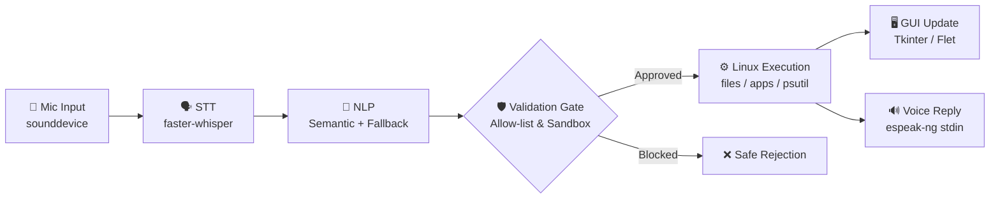

# 🎙️ Voice-Enhanced Linux (Sound Operating System)


**Voice-Enhanced Linux** is a modular, bilingual (**English & Arabic**) user-space voice interaction layer designed for **Ubuntu Linux**. It allows users to control operating system tasks—such as file management, application control, and system monitoring—entirely by voice, bridging natural spoken language and Linux system calls through a secure, multi-stage pipeline and dual graphical interfaces (**Tkinter** & **Flet**).

---

## 👥 Team Members & Responsibilities

| # | Role | Name (الاسم) | Student ID | Dept. | Responsibilities |
| :-: | :--- | :--- | :---: | :---: | :--- |
| **1** | **Team Leader & Linux System Environment** | **زياد إيهاب عبد المقصود**<br>*(Zyad Ehab)* | `352400564` | Math & CS | • Prepares Ubuntu, the Python environment, the Shell setup, and `0700` file permissions.<br>• Sets up the GitHub repository, shared module interfaces, and core documentation.<br>• Wires the central pipeline and model pre-warming in `main.py`. |
| **2** | **Command Execution & Validation Engineer** | **محمد سيد محمد الدحداحي**<br>*(Mohamed Sayed Eldhdahy)* | `352400942` | Stat & CS | • Builds the validation gate: strict allow-lists, safe workspace rules, and confirmation flags.<br>• Routes approved operations safely (`execution/runner.py`) without raw shell execution.<br>• Implements live process list and CPU, RAM, and disk telemetry via `psutil`. |
| **3** | **Speech-to-Text Engineer** | **كريم إبراهيم صلاح الدين**<br>*(Karim Ibrahim)* | `352400827` | Math & CS | • Captures microphone input using a producer/consumer `sounddevice` stream.<br>• Integrates `faster-whisper` for offline Arabic and English recognition.<br>• Implements audio preprocessing (DC removal, silence trimming, gain boost) and error handling. |
| **4** | **Command Understanding / NLP Engineer** | **زياد خالد محمد**<br>*(Zyad Khaled)* | `352400568` | Stat & CS | • Defines supported intents and bilingual example phrases (`nlp/intents.py`).<br>• Integrates multilingual semantic matching (`Sentence Transformers`) with a keyword-matching fallback.<br>• Builds Arabic normalization, parameter extraction, and multi-command injection guards. |
| **5** | **File & Application Management Engineer** | **كريم عمرو محمد**<br>*(Karim Amr)* | `352400832` | Stat & CS | • Implements atomic file creation, listing, renaming, and safe deletion inside `~/VoiceLinuxWorkspace`.<br>• Implements launching (detached processes) and graceful closing (`SIGTERM` ➔ `SIGKILL`) of apps.<br>• Returns clear bilingual status messages for every operation. |
| **6** | **GUI / UX & Voice Feedback Engineer** | **عبدالرحمن خالد محمد**<br>*(Abdelrahman Khaled)* | `352401468` | Math & CS | • Builds the desktop interfaces (Tkinter & modern Flet UI) with background worker threads.<br>• Integrates `espeak-ng` via `stdin` pipes to speak every result in Arabic and English.<br>• Keeps the UI responsive through event-driven status updates (`gui/events.py`). |
| **7** | **Testing & Integration Engineer** | **محمد سيد يوسف محمد**<br>*(Mohamed Sayed Youssef)* | `352400943` | Math & CS | • Writes 235 unit, integration, and security test cases (`pytest`) across all modules.<br>• Manages GitHub Pull Request reviews and cross-module compatibility.<br>• Coordinates final documentation and end-to-end demo verification. |

---

## 🖥️ Interface Preview

| Classic Desktop UI (`Tkinter` — `main`) | Modern Bilingual UI (`Flet` — `feat/flet-modern-gui`) |
| :---: | :---: |
|  |  |

---

## ✨ Key Features

- **🌐 Bilingual Voice Interaction:** Full offline support for both **English** and **Arabic** voice commands with spoken audio feedback via `espeak-ng`.
- **⚡ Pre-Warmed Speech-to-Text (STT):** Pre-loads `faster-whisper` (`small`, `int8`) and NLP embeddings into RAM on startup for instant voice response.
- **🧠 Hybrid NLP Engine:** Combines multilingual semantic embeddings (`sentence-transformers`) with a deterministic keyword-fallback engine to handle phrasing variations and Egyptian Arabic colloquialisms (e.g., *"شوفلي الملفات"*).
- **📊 Live System Monitoring:** Speak natural commands to inspect live CPU, RAM, Disk usage, and top memory-consuming processes via `psutil`.
- **📝 Session Command History:** Logs every command with its timestamp, recognized intent, and final execution state (`Completed`, `Rejected`, `Cancelled`, `Failed`).
- **🛡️ Defense-in-Depth Security & OS Concepts:**
  - **Zero Direct Shell Execution:** Spoken text is never passed to a shell (`shell=True` is strictly prohibited); commands run as explicit argument lists.
  - **Strict Whitelisting & Re-Validation:** Only allow-listed intents, applications, and system resources are accepted, and `runner.py` re-validates every request before execution.
  - **Sandboxed Workspace (`0700`):** All file operations are confined to `~/VoiceLinuxWorkspace` (`drwx------`) with path-traversal and symlink-escape blocking.
  - **Multi-Command & Destructive Guards:** Blocks command chaining (`;`, `&`, `and`, `ثم`), blocks mass-deletion wildcards (`all`, `كل`), and requires explicit GUI confirmation before deleting files or closing applications.

---

## 🏗️ System Architecture & Pipeline

Every voice command passes through 6 sequential, decoupled stages orchestrated by `main.py`:



1. **Voice Capture (`stt/recorder.py`):** Producer/consumer audio stream (`16 kHz` mono `float32`) with automatic silence end-pointing.
2. **Speech-to-Text (`stt/transcriber.py`):** Cleans audio (DC offset removal, silence trimming, gain normalization) and transcribes English/Arabic speech via `faster-whisper`.
3. **Command Understanding (`nlp/understanding.py`):** Maps text to one of 9 supported intents and extracts target parameters (`name`, `new_name`, `app`, `resource`).
4. **Validation Gate (`validation/validator.py`):** Enforces allow-lists, blocks path traversal, and requests user confirmation for `DELETE_FILE` and `CLOSE_APPLICATION`.
5. **Linux Operation (`execution/`):** Executes approved operations using Python OS APIs (`files.py`, `apps.py`, `system_info.py`, `runner.py`).
6. **GUI & Voice Reply (`gui/` or `gui_flet/` & `tts/`):** Updates the interface via thread-safe events and speaks the response via `espeak-ng`.

---

## 🎨 Dual-GUI Architecture (Tkinter & Modern Flet UI)

Because the backend pipeline is decoupled from the presentation layer via an event-driven contract (`gui/events.py`), the project supports **two interchangeable frontends**:

1. **Classic Desktop UI (`Tkinter` — Default on `main`):**
   - Lightweight, zero-overhead native desktop interface (`main.py` & `gui/`) with background threading, Arabic text reshaping, and a live `Treeview` history log.
2. **Modern Next-Gen UI (`Flet` — Available on [`feat/flet-modern-gui`](../../tree/feat/flet-modern-gui)):**
   - Modern desktop dashboard (`main_flet.py` & `gui_flet/`) built with **Flet (Flutter for Python)** featuring native Arabic/English RTL mirroring, a live 5-stage pipeline visualizer, audio spectrum bars, and live OS telemetry.

---

## 📂 Project Structure

```text
Voice_Enhanced_Linux/
├── main.py                  # Main entry point, model pre-warming & pipeline controller (Tkinter UI)
├── main_flet.py             # Entry point for the modern Flet UI (on feat/flet-modern-gui)
├── stt/                     # Audio capture (recorder.py), Whisper STT (transcriber.py) & preprocessing
├── nlp/                     # Intent definitions (intents.py) & hybrid NLP engine (understanding.py)
├── validation/              # Security gatekeeper, allow-lists & sandbox checks (validator.py)
├── execution/               # Safe OS operations: files.py, apps.py, system_info.py & runner.py
├── gui/                     # Classic Tkinter UI (app.py), Arabic shaping (arabic.py) & events.py
├── gui_flet/                # Modern bilingual Flet UI components (on feat/flet-modern-gui)
├── tts/                     # Offline bilingual Text-to-Speech via espeak-ng (speaker.py)
├── tests/                   # 235 automated pytest unit, integration & security tests
├── setup_env.sh             # Automated Ubuntu dependency & virtual environment setup script
└── requirements.txt         # Python package dependencies
```

---

## 🎯 Supported Commands (9 Core Intents)

| Category | Intent | English Example | Arabic Example | Confirmation? |
| :--- | :--- | :--- | :--- | :---: |
| **Files & Folders** | `LIST_FILES` | *"Show my files"* | *"اعرض الملفات"* | No |
| | `CREATE_FILE` | *"Create file test.txt"* | *"انشئ ملف test.txt"* | No |
| | `CREATE_FOLDER` | *"Create folder docs"* | *"انشئ مجلد جديد docs"* | No |
| | `RENAME_FILE` | *"Rename notes to report"* | *"غير اسم notes إلى report"* | No |
| | `DELETE_FILE` | *"Delete file test.txt"* | *"احذف الملف test.txt"* | **Yes** ⚠️ |
| **Applications** | `OPEN_APPLICATION` | *"Open Firefox"* / *"Open Calculator"* | *"افتح فايرفوكس"* / *"افتح الحاسبة"* | No |
| | `CLOSE_APPLICATION` | *"Close Firefox"* / *"Close Terminal"* | *"اغلق فايرفوكس"* / *"اقفل المتصفح"* | **Yes** ⚠️ |
| **System Monitor** | `SHOW_PROCESSES` | *"Show running processes"* | *"اعرض العمليات الجارية"* | No |
| | `SHOW_SYSTEM_USAGE` | *"Show CPU usage"* / *"Memory usage"* | *"استخدام المعالج"* / *"كم الذاكرة المستخدمة"* | No |

---

## 🛠️ Tech Stack

| Component | Technology / Tool | Purpose |
| :--- | :--- | :--- |
| **Operating System** | Ubuntu 26.04.1 LTS | Open-source Linux environment |
| **Language** | Python 3 | Core programming language for all modules |
| **Audio Capture** | `sounddevice` | Records microphone input |
| **Speech-to-Text** | `faster-whisper` (`small`) | Offline bilingual speech recognition |
| **NLP / Embeddings** | `sentence-transformers` | Multilingual semantic intent matching (`paraphrase-multilingual-MiniLM-L12-v2`) |
| **OS & Process API** | `subprocess`, `psutil`, `pathlib` | Safe command execution, file handling & system metrics |
| **Text-to-Speech** | `espeak-ng` | Offline Arabic & English voice feedback |
| **Graphical UI (Primary)** | `Tkinter` (`arabic-reshaper`, `python-bidi`) | Lightweight desktop GUI with background threading & RTL Arabic support |
| **Graphical UI (Modern)** | `Flet` *(on `feat/flet-modern-gui`)* | Modern RTL/LTR dashboard, live pipeline visualizer & telemetry |
| **Testing** | `pytest` | Unit and integration test suite |

---

## 🚀 Getting Started

### 1. Prerequisites
Ensure you are running **Ubuntu Linux** with Python 3.10+ and required system packages installed:

```bash
sudo apt update
sudo apt install python3-pip python3-venv python3-tk portaudio19-dev espeak-ng -y
```

### 2. Installation
Clone the repository and run the automated setup script:

```bash
git clone [https://github.com/ZyadEhab/Voice_Enhanced_Linux.git](https://github.com/ZyadEhab/Voice_Enhanced_Linux.git)
cd Voice_Enhanced_Linux
chmod +x setup_env.sh
./setup_env.sh
```

*(Alternatively, manual virtual environment setup)*:

```bash
python3 -m venv venv
source venv/bin/activate
pip install -r requirements.txt
```

### 3. Running the Application

**Option A — Classic Tkinter GUI (`main` branch):**
```bash
python3 main.py
```

**Option B — Modern Flet GUI (`feat/flet-modern-gui` branch):**
```bash
git checkout feat/flet-modern-gui
pip install flet
python3 main_flet.py
```

*Note: On launch, the system pre-warms the STT and NLP models in the background. Once the status badge turns green (**Ready**), click **Listen** and speak your command.*

### 4. Running Automated Tests
Execute the full unit, integration, and security test suite:

```bash
python3 -m pytest -v
```
*(Expected output: `235 passed`)*
